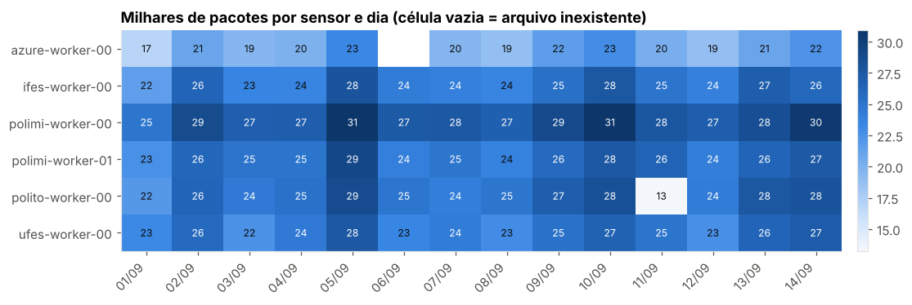
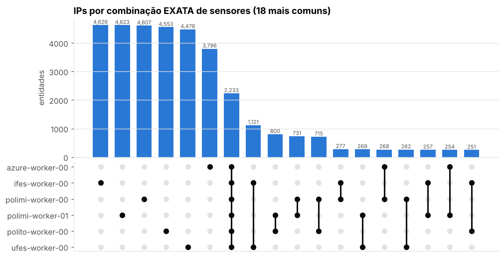
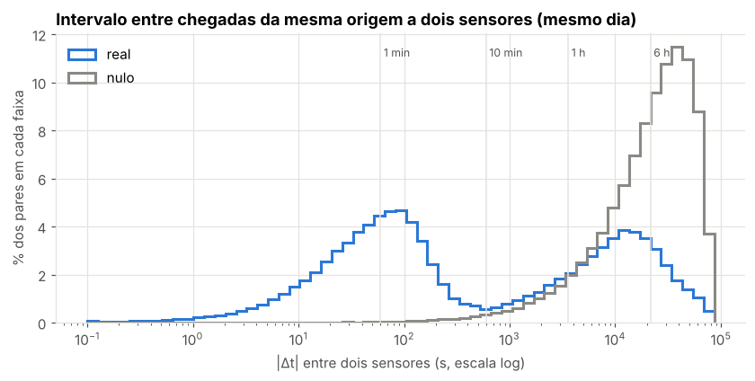
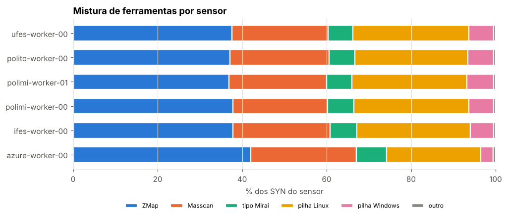
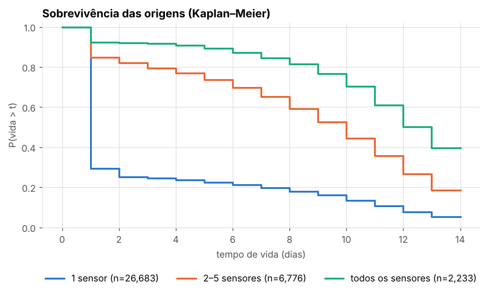
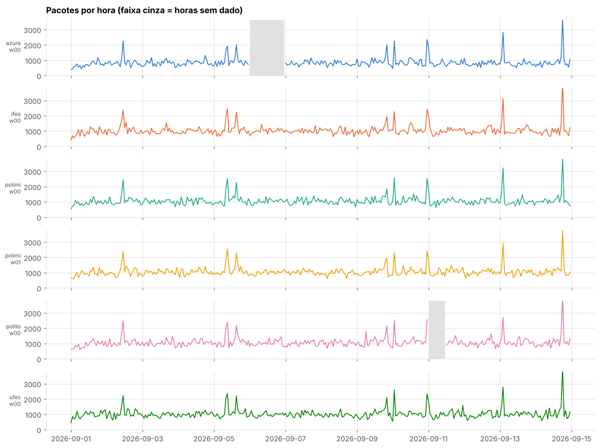

# Holoscope · Coocorrência espaço-temporal em sensores de darknet

Série didática de notebooks Jupyter para analisar **quem** é visto por **quais** sensores de darknet do
[Holoscope](https://arxiv.org/abs/2512.19842), e **quando**. São 7 notebooks em dificuldade crescente: os
primeiros fazem contagens simples, os últimos tratam de simultaneidade com modelo nulo, censura e estimativa de
ataques DDoS. Inclui um leitor para o formato real dos dados (vários parquet por sensor e por dia) e um gerador
de dados fictícios no mesmo formato.

> Os notebooks rodam **sem acesso aos dados reais**. Na primeira execução, um conjunto sintético é gerado
> automaticamente. Para usar os dados reais, troque **uma linha** (`PASTA = ...`).

<p align="center">
  
</p>

---

## Sumário

- [O que é uma darknet](#o-que-é-uma-darknet)
- [Instalação](#instalação)
- [Uso rápido](#uso-rápido)
- [Os notebooks](#os-notebooks)
- [Formato dos dados](#formato-dos-dados)
- [API do leitor](#api-do-leitor)
- [Dados sintéticos](#dados-sintéticos)
- [Estrutura do repositório](#estrutura-do-repositório)
- [Para orientadores](#para-orientadores)
- [Referência](#referência)

---

## O que é uma darknet

Uma **darknet** (ou *telescópio de rede*) é um bloco de endereços IP **sem nenhum serviço**. Tudo o que chega a ela
é não solicitado:

| O que chega | Por quê | Como aparece |
|---|---|---|
| **Varreduras** | alguém procurando portas abertas na internet | TCP `SYN`, UDP, ICMP |
| **Backscatter** | a vítima de um DDoS com origem forjada responde para endereços aleatórios | TCP `SYN-ACK`, `RST` |
| **Configuração errada** | equipamentos mal configurados | variado |

O Holoscope tem sensores no Brasil (Ufes/Ifes), na Itália (Politecnico di Milano, Politecnico di Torino…) e na nuvem
(Azure). A pergunta desta série é **o que os sensores veem em comum, e quando**. Ela usa apenas dados agregados:
interseções, distribuições e séries temporais, por IP, rede /24, ASN ou país de origem.

## Instalação

Requer Python ≥ 3.10.

```bash
git clone <url-deste-repositório> holoscope-serie
cd holoscope-serie
python -m venv .venv && source .venv/bin/activate
pip install -r requirements.txt
jupyter lab
```

Testado com Python 3.13, pandas 3.0, pyarrow 26, matplotlib 3.11 e numpy 2.5.

## Uso rápido

**Nos notebooks:** abra `00_leitura_e_validacao.ipynb` e siga a ordem. No início de cada notebook:

```python
# >>> Para usar os DADOS REAIS, troque só esta linha pela pasta dos parquet <<<
PASTA = os.path.join(RAIZ, "dados_sinteticos")
```

**Em código próprio:**

```python
import holoscope_io as hio

inv = hio.inventario("caminho/dos/parquet")       # sensor × dia × arquivo (não lê os dados)
df  = hio.carregar_holoscope(inv,
                             sensores=["ufes-worker-00", "polimi"],   # sensores ou sites
                             inicio="2026-09-01", fim="2026-09-07",
                             extras=("asn", "geo"))
hio.validar(df)
```

## Os notebooks

| # | Notebook | Nível | Pergunta central | Técnicas |
|---|---|---|---|---|
| 00 | `00_leitura_e_validacao` | base | Como ler e validar os parquet? | inventário sensor × dia, unidades, IP como inteiro, flags como bits, origens privadas, processamento arquivo a arquivo |
| 01 | `01_panorama_por_sensor` | 🟢 fácil | Como é o tráfego de cada sensor? | `groupby`, `crosstab`, pacotes × IPs distintos, portas, varredura × backscatter, CCDF log-log |
| 02 | `02_quem_ve_o_que` | 🟢→🟡 | Quem é visto por quais sensores? | matriz de presença, Jaccard, P(B\|A), lift, gráfico UpSet, IP → /24 → ASN, **modelo nulo** |
| 03 | `03_tempo` | 🟡 médio | Como o tráfego varia no tempo? | séries horárias, buracos × zeros, correlação, ciclo diário e fuso, z-score robusto, curva de descoberta |
| 04 | `04_impressoes_digitais` | 🟡 médio | Que ferramentas varrem os sensores? | assinaturas (TTL, `ip_id`, janela, opções TCP), ZMap/Masscan/tipo Mirai, alcance, saltos |
| 05 | `05_simultaneidade` | 🔴 difícil | Os sensores são varridos ao mesmo tempo? | Δt entre sensores, nulo dentro do dia, matriz de precedência, erro de relógio |
| 06 | `06_persistencia_e_eventos` | 🔴 difícil | Quanto duram as origens? Que ataques vimos? | Kaplan–Meier com censura, DDoS por backscatter (extrapolação 2³²/N), pools /24, estudos de caso por regra |

Todos os notebooks seguem a mesma estrutura:

- pergunta de pesquisa e conceitos de redes explicados para quem está começando;
- análises **prontas**, com gráfico e um parágrafo de leitura guiada;
- avisos de **⚠️ armadilha** com erros comuns de interpretação;
- **4 TODOs** com dica e uma célula de verificação automática, que responde ✅ quando está certo e ⏳ enquanto
  não foi resolvido;
- **desafios** abertos no fim, sem solução.

<table>
<tr>
<td></td>
<td></td>
</tr>
<tr>
<td align="center"><sub>02 · IPs por combinação exata de sensores (UpSet)</sub></td>
<td align="center"><sub>05 · Δt entre sensores: real × modelo nulo</sub></td>
</tr>
<tr>
<td></td>
<td></td>
</tr>
<tr>
<td align="center"><sub>04 · Ferramentas de varredura por sensor</sub></td>
<td align="center"><sub>06 · Sobrevivência das origens (Kaplan–Meier)</sub></td>
</tr>
</table>

## Formato dos dados

### Arquivos

- **Um parquet por sensor e por dia**, sem coluna de sensor: o sensor e o dia estão no **caminho** do arquivo.
- O leitor reconhece três organizações (a lista está em `hio.PADROES` e pode ser trocada pelo parâmetro `padroes=`):

| Organização | Exemplo |
|---|---|
| tudo na mesma pasta | `ufes-worker-00-2026-09-01.parquet` |
| uma subpasta por sensor | `ufes-worker-00/2026-09-01.parquet` |
| estilo Hive/Spark | `sensor=ufes-worker-00/dia=2026-09-01/part-0.parquet` |

- O **site** sai do nome do sensor: `polimi-worker-01` → `polimi`. Por padrão, cada *worker* é um sensor. Com
  `unidade="site"`, os workers de um mesmo site são somados.

### Colunas

| Coluna | Tipo no arquivo | Conteúdo | No `DataFrame` carregado |
|---|---|---|---|
| `timestamp` | int64 | epoch em **nanossegundos, UTC** | `ts` (datetime UTC) |
| `src_ip`, `dst_ip` | uint32 | IPv4 como inteiro | mantidos (use `hio.ip_texto` para exibir) |
| `src_port`, `dst_port` | uint16 | portas | mantidos |
| `transport_proto` | dictionary | TCP / UDP / ICMP | categoria |
| `app_proto` | dictionary | serviço provável (HTTP, SSH, SNMP…) | extra `"app"` |
| `tcp_flags` | uint8 | bitmask (FIN=1, SYN=2, RST=4, PSH=8, ACK=16, URG=32, ECE=64, CWR=128) | mantido (use `hio.flags_texto`) |
| `ttl`, `ip_id`, `ip_df`, `window`, `pkt_len`, `mss`, `wscale`, `has_sack`, `has_ts`, `tcp_options_ordered` | vários | campos de cabeçalho | extra `"fingerprint"` |
| `flow_hash` | uint64 | identificador do fluxo | extra `"fluxo"` |
| `src_asn` | struct `{asn, network, organization_name}` | AS de origem | extra `"asn"` → `asn`, `asn_rede`, `asn_org` |
| `src_geo` | struct `{continent_name, country_iso_code, country_name, location{lat, lon}}` | geolocalização | extra `"geo"` → `continente`, `pais`, `pais_nome`, `lat`, `lon` |

### Cuidados com os dados reais

- **Origens privadas/reservadas** (`10/8`, `172.16/12`, `192.168/16`…) não são tráfego da internet: em geral são
  gerência da rede do próprio sensor (num arquivo real de teste, 100% era SNMP interno). O leitor as **descarta por
  padrão** e informa quantas foram descartadas.
- **Dia sem arquivo ≠ dia sem tráfego.** Use `NaN`, nunca 0.
- **Memória.** O struct `src_asn` traz um dicionário grande de nomes repetido em cada *row group*. Quando ele é
  pedido, o leitor lê **um row group por vez**. Num arquivo real de 90 mil linhas, o pico caiu de ~1,8 GB para
  ~340 MB. Peça só os `extras` que for usar.

## API do leitor

`holoscope_io.py`

| Função | O que faz |
|---|---|
| `inventario(pasta, padroes=None)` | lista os parquet e extrai `sensor`, `site` e `dia`; lê só os metadados (linhas, MB) |
| `matriz_inventario(inv, "linhas")` | tabela sensor × dia (célula vazia = arquivo inexistente) |
| `carregar_holoscope(fonte, sensores, inicio, fim, extras, colunas, unidade, remover_reservados)` | lê e normaliza vários arquivos em um `DataFrame` |
| `agregar_por_arquivo(fonte, func, ...)` | aplica `func(df)` a um arquivo (sensor, dia) por vez e junta os resultados; serve para dados que não cabem na memória |
| `ler_arquivo(caminho, colunas)` | lê um parquet e achata os structs |
| `validar(df)` | confere fuso, anos plausíveis, origens reservadas, prefixos de destino e ASN ausente |
| `ip_texto`, `ip_inteiro`, `prefixo`, `rede_texto` | conversões de IP |
| `flags_texto`, `ttl_inicial`, `saltos`, `eh_reservado` | auxiliares de cabeçalho |

`holoscope_ana.py` reúne as funções de análise e de gráfico usadas nos notebooks: `adicionar_entidades`,
`matriz_presenca`, `jaccard`, `condicional`, `lift`, `combinacoes`, `grafico_upset`, `ecdf`, `ccdf`,
`primeira_vez`, `delta_pares`, `embaralhar_colunas`, `kaplan_meier`, `heatmap`, `barras_h`, `cores` e `estilo`.

## Dados sintéticos

`gerar_sintetico_real.py` gera dados **fictícios** no mesmo formato dos reais: 6 sensores (5 sites), 14 dias,
cerca de 2 milhões de pacotes e 83 arquivos, em uns 70 MB.

```bash
python gerar_sintetico_real.py                       # → dados_sinteticos/
python gerar_sintetico_real.py --dias 7 --escala 0.5 --saida teste/
```

Tudo é inventado: os destinos ficam em `198.18.0.0/15` (bloco reservado para testes), os ASNs estão na faixa privada
(64512+) e os nomes de organização são fictícios. Os nomes dos sensores só imitam o padrão real. O gerador embute
fenômenos típicos de darknet e também **falhas de coleta**, para serem redescobertos nas análises.

<p align="center">
  
</p>

## Estrutura do repositório

```
.
├── 00_leitura_e_validacao.ipynb … 06_persistencia_e_eventos.ipynb   # notebooks (TODOs em aberto)
├── holoscope_io.py            # leitor do formato real
├── holoscope_ana.py           # análise + estilo de gráficos
├── gerar_sintetico_real.py    # gerador de dados fictícios
├── requirements.txt
├── docs/img/                  # figuras deste README
├── solucoes/                  # notebooks com TODOs resolvidos + PROFESSOR.md
└── _construcao/               # fontes dos notebooks (conteudo_XX.py) e scripts de montagem
```

Os `.ipynb` são **gerados** a partir de `_construcao/conteudo_XX.py`. Para mudar um texto ou um TODO, edite o
conteúdo e regenere:

```bash
python _construcao/construir.py 03     # monta o 03 (versão aluna + solução)
_construcao/rodar.sh 03                # monta, executa e confere as verificações
```

## Para orientadores

- `solucoes/` tem as resoluções de todos os TODOs, já executadas.
- `solucoes/PROFESSOR.md` lista os fenômenos embutidos no sintético, os resultados esperados, pontos de discussão
  e o que revisar ao trocar para os dados reais.
- Se o repositório for público e usado em aula, considere manter `solucoes/` num branch ou repositório separado.

## Referência

Os dados vêm do Holoscope:

> *Holoscope: Open and Lightweight Telescope & Honeypot Platform.* arXiv:2512.19842.

O método de estimar a intensidade de ataques a partir do backscatter (notebook 06) segue
Moore, Voelker e Savage, *Inferring Internet Denial-of-Service Activity* (USENIX Security, 2001).

---

Desenvolvido no contexto de iniciação científica na Universidade Federal do Espírito Santo (Ufes).
